# STM32 GNSS Test System

## 1. Project Overview

This project implements an embedded test system for communicating with a SIM7000E cellular/GNSS module using AT commands.

The system is based on an STM32F103C8T6 microcontroller and provides a serial interface for a PC application. The microcontroller receives requests from the PC, executes the corresponding operations on the SIM7000E module, processes the responses, and returns structured results to the PC.

An I2C character LCD displays the current system state and the latest operation results.

### Main features

- Communication between the PC and STM32 over UART.
- Communication between STM32 and SIM7000E using AT commands.
- Module information retrieval, including IMEI and firmware version.
- GNSS power control.
- GNSS fix and position retrieval.
- Framed communication protocol with payload validation.
- Non-blocking UART communication using DMA and idle-line detection.
- LCD status and result display.

## 2. Wiring Diagram



## 3. Communication Protocol

### 3.1. Overview

The PC application and the STM32 microcontroller communicate over UART using a binary framed protocol.

The protocol provides:
- Frame boundary detection using a fixed Start of Frame (SOF) marker.
- Payload length identification.
- Command and response identification.
- Request-response correlation using a sequence number.
- Error reporting through frame flags and response status fields.
- Data integrity verification using CRC-16/CCITT-FALSE.
- Extensible response data encoding using Type-Length-Value (TLV).

### 3.2. Frame Structure

Each protocol frame has the following structure:

| Field | Size | Description |
|---|---:|---|
| SOF | 2 bytes | Start of Frame marker: `0xA5 0x5A` |
| LEN | 1 byte | Length of `FLAGS + CMD + SEQ + DATA` |
| FLAGS | 1 byte | Request/Response and error flags |
| CMD | 1 byte | Command identifier |
| SEQ | 1 byte | Sequence number |
| DATA | 0-252 bytes | Command parameters or response payload |
| CRC | 2 bytes | CRC-16/CCITT-FALSE checksum |

The SOF marker and CRC are not included in `LEN`.

The `LEN` field includes `FLAGS`, `CMD`, `SEQ`, and `DATA`.

Therefore:

```text
LEN = 3 + DATA_LENGTH
FRAME_LENGTH = 2 + 1 + LEN + 2
```

The `DATA` field can contain up to 252 bytes when the maximum value of `LEN` is 255.

### 3.3. FLAGS Field

The `FLAGS` field contains bit flags describing the frame.

Two flags are defined:

| Flag | Description |
|---|---|
| `RESPONSE` | Indicates that the frame is a response rather than a request |
| `ERROR` | Indicates that the frame represents an error condition |

### 3.4. CMD Field

The `CMD` field identifies the operation associated with the frame.

Requests and their corresponding responses use the same command identifier. The `RESPONSE` flag distinguishes a response from a request.

The command identifiers and their associated payload formats are defined by the application protocol.

### 3.5. SEQ Field

The `SEQ` field contains an 8-bit sequence number used to correlate requests with responses.

The PC application assigns a sequence number to a request. The STM32 copies the same sequence number into the corresponding response.

This allows the PC application to associate a received response with the request that initiated it.

### 3.6. DATA Field

The `DATA` field contains command-specific parameters or response data.

For requests, `DATA` contains the parameters required to execute the requested command.

For responses, `DATA` begins with two bytes:

| Field | Size | Description |
|---|---:|---|
| STATUS | 1 byte | Indicates the operation result |
| ERROR_CODE | 1 byte | Identifies the specific error, when applicable |
| TLV DATA | Variable | Contains structured response fields |

The two-byte status prefix is part of `DATA` and is included in `LEN` and the CRC calculation.

The meaning of each status value and error code must be defined by the application protocol. For successful operations, `ERROR_CODE` should use the implementation's defined success value.

### 3.7. Type-Length-Value (TLV) Encoding

Response data after `STATUS` and `ERROR_CODE` is encoded using the Type-Length-Value (TLV) format.

Each TLV element consists of:

| Field | Size | Description |
|---|---:|---|
| TYPE | 1 byte | Identifies the data field |
| LENGTH | 1 byte | Length of the value in bytes |
| VALUE | Variable | Encoded field value |

A response can contain multiple TLV elements concatenated sequentially:

```text
STATUS | ERROR_CODE | TLV_1 | TLV_2 | ... | TLV_N
```

The receiver determines the end of each TLV element using its `LENGTH` field. The TLV parser must validate that each element fits completely within the remaining response data.

Unknown TLV types may be skipped using their length, provided the TLV structure is valid and the application protocol permits unknown fields.

### 3.8. CRC Validation

The protocol uses **CRC-16/CCITT-FALSE** to detect transmission errors.

Parameters:

| Parameter | Value |
|---|---|
| Width | 16 bits |
| Polynomial | `0x1021` |
| Initial value | `0xFFFF` |
| Input reflection | Disabled |
| Output reflection | Disabled |
| Final XOR | `0x0000` |
| Check value for `"123456789"` | `0x29B1` |

The CRC is calculated over the following fields, in order:

```text
LEN | FLAGS | CMD | SEQ | DATA
```

The following fields are excluded from the CRC calculation:
- `SOF`
- `CRC`

The resulting 16-bit checksum is transmitted in the CRC field. The byte order used to serialize the checksum must be consistent between the PC application and STM32 firmware.

A received frame must pass CRC validation before its command is executed or its response data is accepted.

### 3.9. Frame Parsing and Validation

The receiver processes UART data as a continuous byte stream. A single UART reception may contain a partial frame, one complete frame, or multiple consecutive frames.

A frame is processed as follows:

1. Search for the SOF sequence `0xA5 0x5A`.
2. Read the `LEN` field.
3. Validate `LEN` against the supported frame-size limits.
4. Wait until the complete frame has been received.
5. Calculate and verify CRC-16/CCITT-FALSE.
6. Validate the frame fields and payload structure.
7. Determine whether the frame is a request or response using `FLAGS`.
8. Dispatch valid requests to the corresponding command handler or deliver valid responses to the PC application's response handler.

Frames with invalid lengths, CRC mismatches, or malformed payloads must be rejected. The parser should recover synchronization and continue processing subsequent frames.

### 3.10. Maximum Frame Size

The `LEN` field is one byte and includes three fixed bytes (`FLAGS`, `CMD`, and `SEQ`) plus `DATA`.

Therefore:

```text
DATA_LENGTH = LEN - 3
FRAME_LENGTH = LEN + 5
```

The protocol implementation must reject `LEN` values smaller than `3` because they cannot contain all three mandatory fields.

The maximum accepted `LEN` value must also respect the actual buffer size and the intended maximum payload size.

## 4. LCD Display States

The LCD provides a local indication of the device state without requiring access to the PC application.

The following describes the intended display behavior.

### 4.1. Idle — Waiting for a PC request

**Condition:** No request is currently being processed.

The display indicates that the device is ready and waiting for a command from the PC.

Example:

```text
System Ready
Waiting for PC...
```

### 4.2. Processing — Executing a request

**Condition:** A valid request has been received and the corresponding operation is in progress.

The display indicates that the STM32 is communicating with the SIM7000E and processing the request.

Example:

```text
Processing...
SIM7000E: AT
```

### 4.3. Success — Result received

**Condition:** The modem operation has completed successfully and the response has been transmitted to the PC.

The display shows the latest successfully obtained result, using a compact representation appropriate for a 16×2 LCD.

Example:

```text
Lat: 49.1234
Lon: 23.1234
```

The example coordinates are illustrative only. The actual displayed values must come from the latest valid result.

The latest result may remain visible until another operation starts or a new display state takes priority.

### 4.4 No Fix - No GNSS fix

**Condition:** The modem operation has completed but it failed to get a fix.

The display indicates the absence of a fix, as well as the number of satellites in view and the HDOP value.

Example:

```text
GNSS: No Fix
Sat: 10 HDOP: 0.0
```

On average it takes 30 to 60 seconds for the modem to get a fix.

### 4.4. Error — Operation failed

**Condition:** An operation fails, times out, or returns an error, if this state is implemented.

Example:

```text
ERROR:
AT TIMEOUT
```

Where possible, the display should distinguish communication errors, modem errors, and unavailable GNSS fixes.

A GNSS fix being unavailable is not necessarily a communication failure: the modem can respond correctly while reporting that no valid fix is available.

## 5. Firmware Architecture

The firmware is organized into separate modules to keep hardware access, protocol processing, and application logic independent.

```text
Core/
├── Inc/
└── Src/
    ├── main.c
    └── ...

App/
├── app.c
└── app.h

Services/
├── Inc/
│   ├── command_handler.h
│   ├── display_service.h
│   ├── gnss_parser.h
│   ├── lcd_i2c.h
│   ├── module_service.h
│   ├── module_types.h
│   ├── protocol.h
│   ├── sim7000.h
│   └── uart_transport.h
└── Src/
    ├── command_handler.c
    ├── display_service.c
    ├── gnss_parser.c
    ├── lcd_i2c.c
    ├── module_service.c
    ├── protocol.c
    ├── sim7000.c
    └── uart_transport.c
```

### Responsibilities

- **Core:** STM32 startup, clock configuration, and CubeMX-generated peripheral initialization.
- **App:** Main application logic, request dispatching, and coordination between services.
- **UART transport:** UART reception and transmission, DMA handling, buffering, and error recovery.
- **Protocol:** Frame encoding/decoding, length validation, CRC verification.
- **Command handler:** Command execution, forming frames, TLV encoding
- **Module service:** Managing AT-commands state machine
- **GNSS parser:** Parsing +CGNSING response from modem
- **SIM7000 service:** AT-command execution, modem response processing, and GNSS operations.
- **LCD i2c:** I2C reception and transmission, display initialization, not blocking display updates.
- **Display service:** Status updates, formatting of result data.

The main loop calls the application processing function regularly. Interrupt callbacks should perform only time-critical operations, such as recording received data or notifying the application that a transfer has completed.

Blocking waits should be avoided in normal operation. State machines and non-blocking transfers help keep the system responsive while the modem is executing commands.

## 6. Limitations and Notes

- GNSS availability and fix acquisition time depend on antenna placement, sky visibility, and reception conditions.
- Module responses may vary with firmware version and network/GNSS state.
- Protocol field definitions must remain synchronized between the STM32 firmware and the PC application.
- The LCD is intended for concise status information; detailed results should be available through the PC application.
